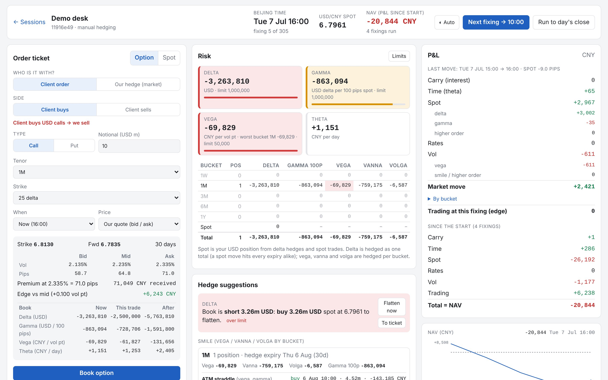
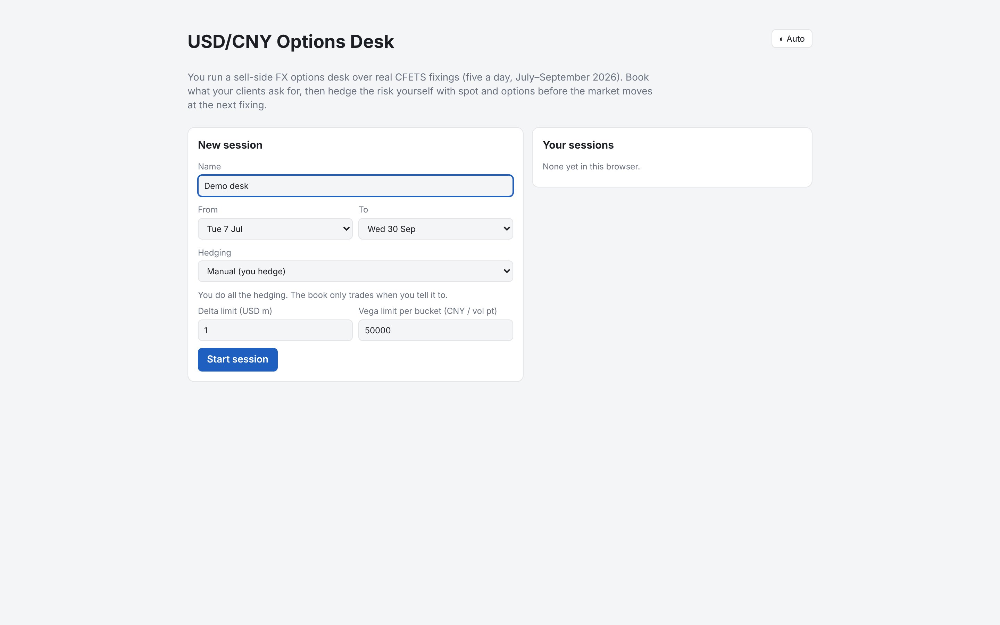
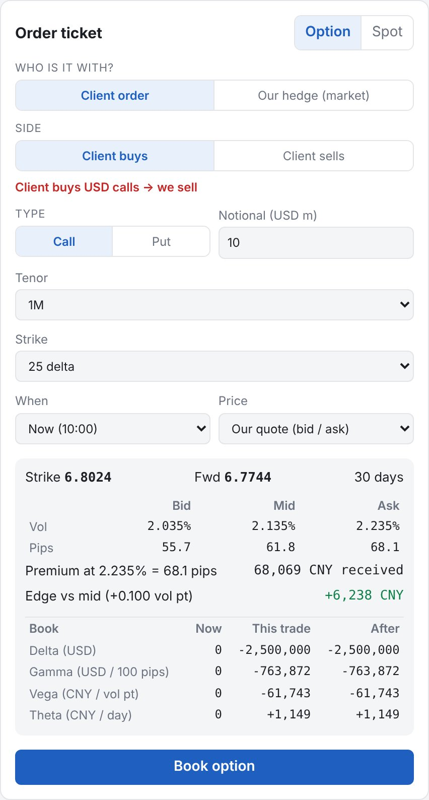
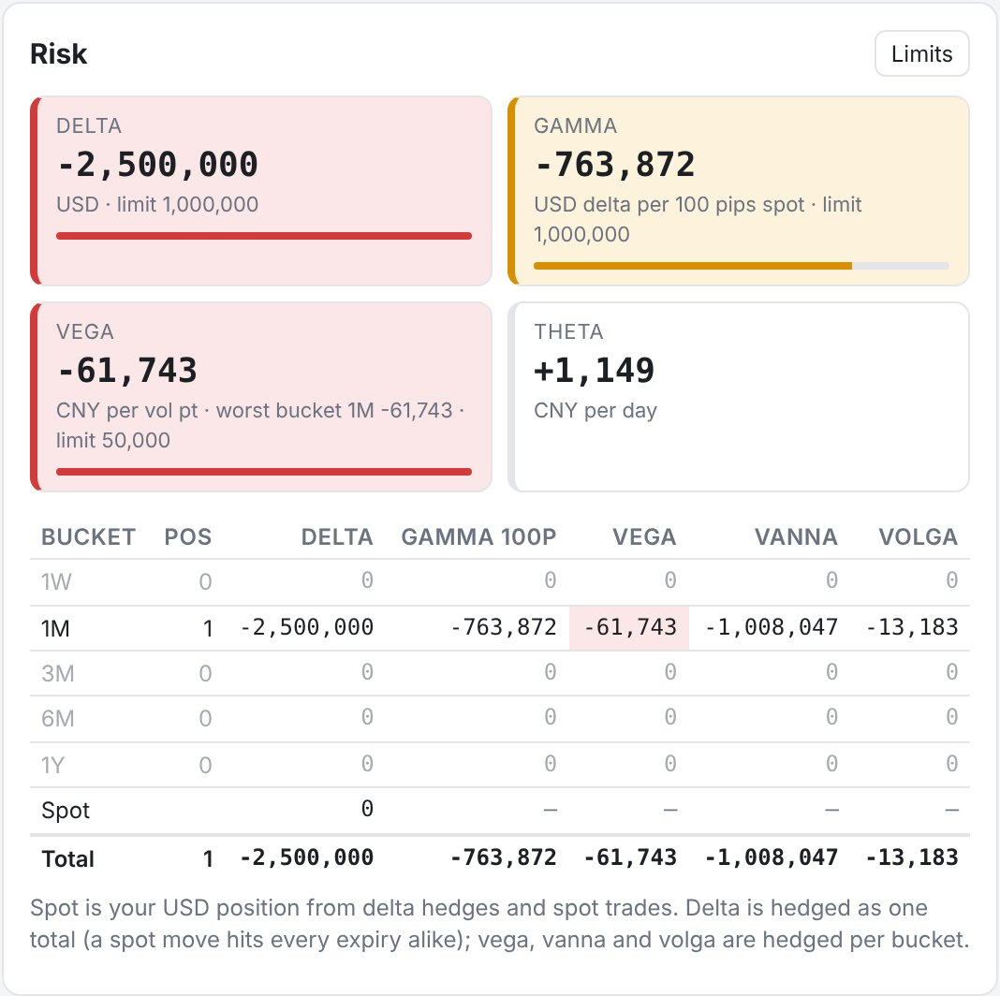
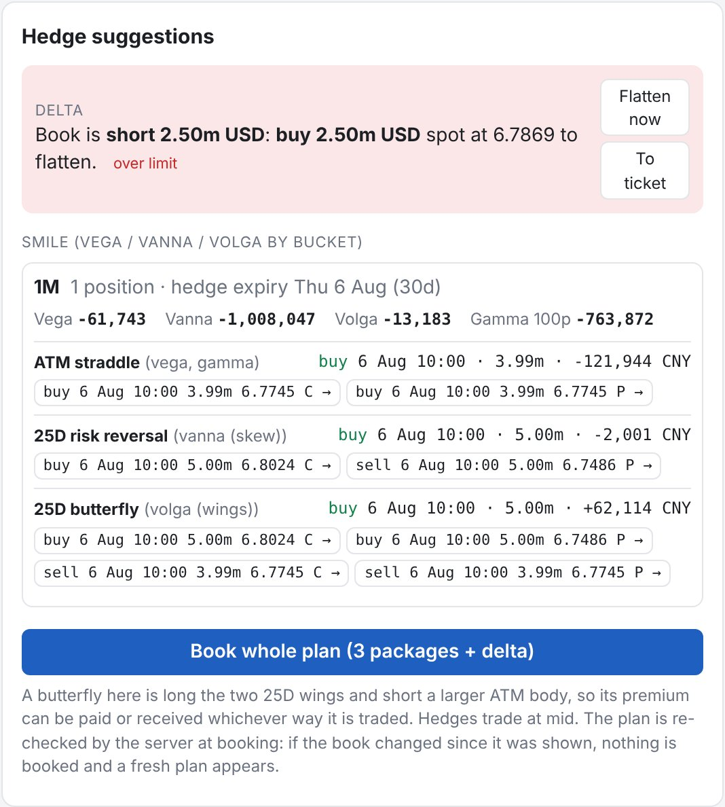
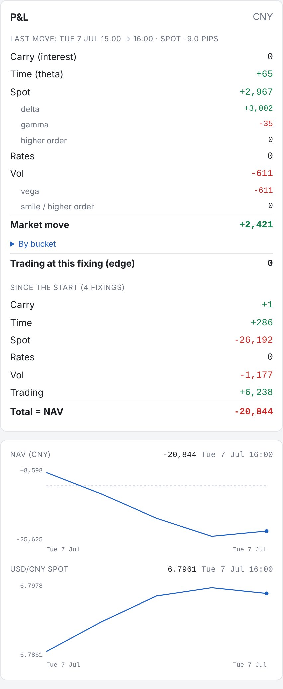
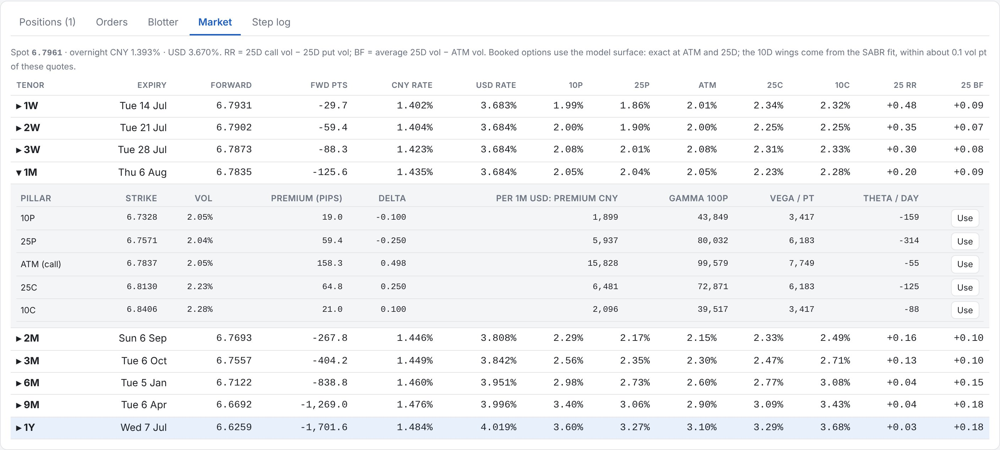
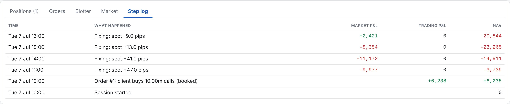

# fx-options-hedger

A USD/CNY options desk simulator. You play the sell-side: clients come to you for options
and spot, you quote and book their trades, and then you have to hedge the risk you've taken
on before the market moves. The market is real. It replays the CFETS USD/CNY fixings from
July to September 2026, five snapshots a day, with the actual vol smiles and rate curves
from those dates.

The pricing and the vol surface are written in C++ (exposed to Python with pybind11 and using
QuantLib for SABR). The book, hedging logic and game rules are Python, served through a
FastAPI backend, with a React front end on top.



## What it does

Each session walks forward through the fixings (10:00, 11:00, 14:00, 15:00 and 16:00 Beijing
time, 305 of them in total). At every fixing you can:

- book client trades: options (calls or puts, any tenor up to 1Y, strikes by delta, ATM,
  ATM forward or a fixed level) and spot
- quote them at a bid/ask around mid, or agree a vol or premium with the client
- hedge with spot and options in the market
- look at your risk (delta, gamma, vega, theta, plus vanna and volga per expiry bucket)
- move the clock to the next fixing and see what the market did to your P&L

When the clock moves, the book earns or pays interest on its cash, options that have
expired are settled at intrinsic value, everything is marked to the new market, and the
change in value is broken down into where it came from: carry, time decay, spot, rates and
vol.

The app also suggests hedges. Delta is flattened with a spot trade. For the smile risk, it
works out, for each expiry bucket, how much ATM straddle, 25-delta risk reversal and 25-delta
butterfly to trade so that the bucket's vega, vanna and volga all go to zero. You can book a
suggestion as is, book it leg by leg, or ignore it.

Sessions are saved, so you can close the page and come back to one later.

## How to use it

1. **Start a session.** Pick a start and end date and a hedging mode. *Manual* is the
   interesting one: nothing gets hedged unless you do it. *End of day* and *threshold*
   hedge automatically, either at each day's close or whenever a limit is breached. You
   can also set the delta and vega limits the risk panel colours against.

   
2. **Take a client trade.** In the order ticket choose *Client order* and the side the client
   wants ("Client buys" means you sell). Pick the option, then a price: your quote (the client
   pays your ask or receives your bid), mid, an agreed vol, or an agreed premium. The quote
   box shows the premium, your edge against mid and what the trade does to your Greeks
   before you book it.

   
3. **Look at the risk panel.** Each Greek is coloured against its limit. The bucket table
   shows where the risk sits by expiry, with a Spot row and a Total row underneath.

   
4. **Hedge.** Either press *Flatten now* for delta and *Book whole plan* for the smile, or
   send individual legs to the ticket (choose *Our hedge (market)*) and trade them yourself.

   
5. **Move the clock.** *Next fixing* goes forward one snapshot, *Run to day's close* goes to
   16:00. The P&L panel then shows what happened: how much came from the spot move (split
   into delta, gamma and the rest), how much from vol, from rates and from time passing.

   
6. **Repeat** until the session runs out of fixings. The tabs at the bottom have your
   positions, orders, every trade, the market (forwards, vols, risk reversals and
   butterflies per tenor) and a log of every step.

   

   

A good first exercise: sell a client 10m of a 1M 25-delta call, don't hedge, run a day and
look at the P&L breakdown. Then do it again, hedged, and compare.

## Components

### Data (`prepare_data.py`, `get_spot.py`)

Run once. They turn the raw downloads into three clean CSVs in `clean/`.

- **Vols:** CFETS USD/CNY implied vols, 9 tenors (1W to 1Y) and 5 quotes each (10-delta put,
  25-delta put, ATM, 25-delta call, 10-delta call) at every fixing. Risk reversal and
  butterfly quotes are dropped because they can be derived from the others. Crossed bid/ask
  quotes are swapped.
- **Rates:** SHIBOR for CNY; US Treasury bills plus SOFR (overnight) for USD. Every quote is
  converted from its own convention (ACT/360 simple, ACT/365 simple, semiannual) to a
  continuously compounded zero rate. Days missing a curve, such as US holidays, reuse the
  previous day's.
- **Spot:** hourly USD/CNY, taken at each fixing time.

The script checks its own output before finishing: 45 vol quotes per fixing, full curves
every day, sensible ranges, no duplicates.

### Pricing engine (`engine/`, C++)

- `yield_curve`: zero rate and discount factor at any maturity, interpolating between the
  quoted points with flat forwards.
- `pricer`: Garman-Kohlhagen price and Greeks (delta, gamma, vega, vanna, volga, theta, rho),
  and a Newton search for the strike with a given delta.
- `smile_vol`: the vol surface. For each tenor, the five quotes are turned into strikes, then:
  - between the 25-delta strikes, vanna-volga, which goes exactly through the 25P, ATM and
    25C quotes
  - in the wings, SABR (beta = 1), fitted to all five quotes with QuantLib
  - between the two, a cubic bridge that matches both the level and the slope at each end.
    It's checked for butterfly arbitrage (Gatheral's density condition) and pushed further
    out if it fails.

  Across tenors, vols are looked up at the same moneyness (strike over forward) and
  interpolated in total variance, with a floor so total variance never falls as maturity
  grows.
- `market_snapshot`: one fixing's spot, curves and surface together. Anything that needs a
  price goes through it, and each option is priced with the rates for its own expiry and
  the vol for its own strike.
- `portfolio`: the option positions, with total Greeks and Greeks by expiry bucket.

### Simulation (`simulation/`, Python)

- `market_loader.py`: reads the CSVs and builds the C++ curves, surface and snapshot for
  any fixing.
- `book.py`: what the desk owns: the options, a USD spot position and CNY cash. It books
  trades, accrues overnight interest on cash and USD, settles expired options at intrinsic
  and computes NAV. Hedge legs with identical terms are netted into one position.
- `hedging.py`: builds the ATM straddle, risk reversal and butterfly packages and solves for
  their sizes, bucket by bucket. When a bucket's options expire at clearly different dates,
  a short-dated straddle is added so gamma is hedged too.
- `pnl.py`: explains a step's P&L by revaluing the book while changing one market input at
  a time (carry, then time, spot, rates, vol). The pieces add up exactly to the actual
  P&L.
- `session.py`: the game. It holds the clock, orders (immediate or waiting for a later
  fixing), quotes, spot trades, the hedging policies and the history of every step. It
  also refuses trades at prices nobody would deal at (an agreed vol more than 50% away from
  mid, or a spot rate more than 2% from spot), so a typo can't wreck a session.

### API (`api/`)

- `app.py`: FastAPI. Many sessions run at once, each under a random id and with its own
  lock, so double clicks can't interleave. It also serves the built front end.
- `journal.py`: SQLite. A session is never saved as state. Its settings and the list of
  actions are stored instead, and after a restart the session is rebuilt by replaying them.
  This works because the engine is deterministic. Idle sessions are unloaded from memory
  and come back on demand.

### Front end (`frontend/`, React)

Order ticket, risk panel with limits, hedge suggestions, P&L breakdown, NAV and spot charts,
and tabs for positions, orders, blotter, market and step log. It shows Greeks in the units a
desk would use (gamma per 100 pips, vega per vol point, theta per day) and has a light/dark
toggle. Sessions are remembered per browser, so each visitor only sees their own.

### Tests (`tests/`)

Sixteen scripts covering every layer. Where possible a result is rebuilt independently
rather than trusted: forwards and discount factors by hand, SABR against a separate Hagan
implementation, no arbitrage across all 2,745 smiles, the P&L explain summing exactly at
every step of a full run, hedged books coming out flat on 300 random portfolios, and
sessions coming back identical after a restart.

```
python3 tests/run_all.py
```

## Running it

You need a C++17 compiler, CMake, QuantLib and pybind11 for the engine, Python 3 with pandas,
numpy, fastapi and uvicorn, and Node for building the front end.

```
cmake -S . -B build && cmake --build build      # builds the fxengine module into build/
cd frontend && npm install && npm run build && cd ..
uvicorn api.app:app                             # then open http://127.0.0.1:8000
```

Settings such as the database path and the admin key for listing sessions go in `.env`.
Run a single uvicorn worker: sessions live in the server's memory.

## Limits worth knowing

- The data is five fixings a day on business days only, so there's no overnight or weekend
  trading, and a step can be an hour, overnight or a whole weekend.
- Suggested hedges trade at mid. Hedges you book through the ticket can pay the market's
  bid/ask instead, if you pick that price.
- Pillar strikes use spot delta (not premium-adjusted) for every tenor.
- Vega is fixed-strike. When the quotes move, the smile also re-centres on the new
  deltas, and that shows up in the vol line of the P&L.